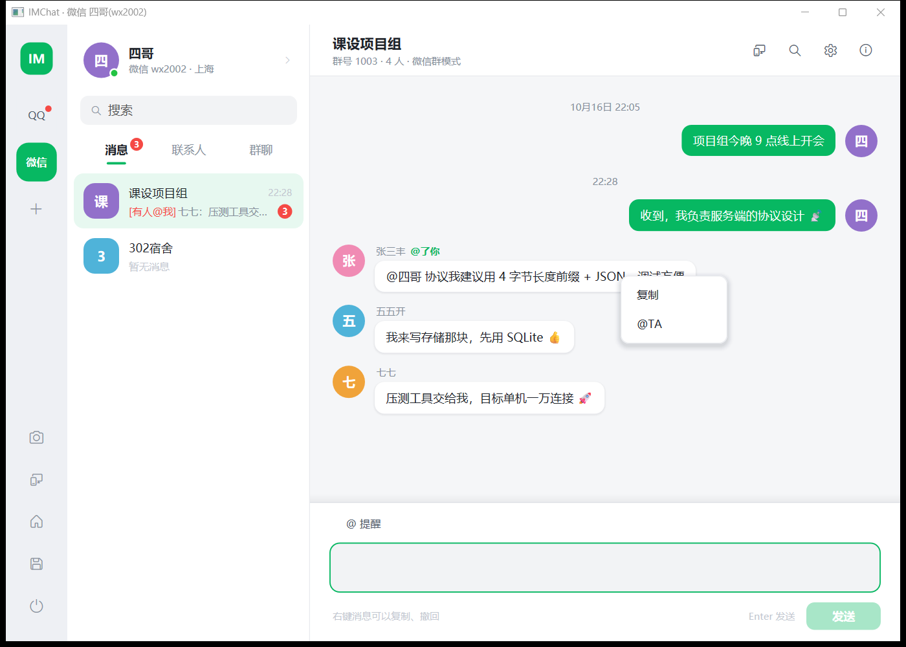
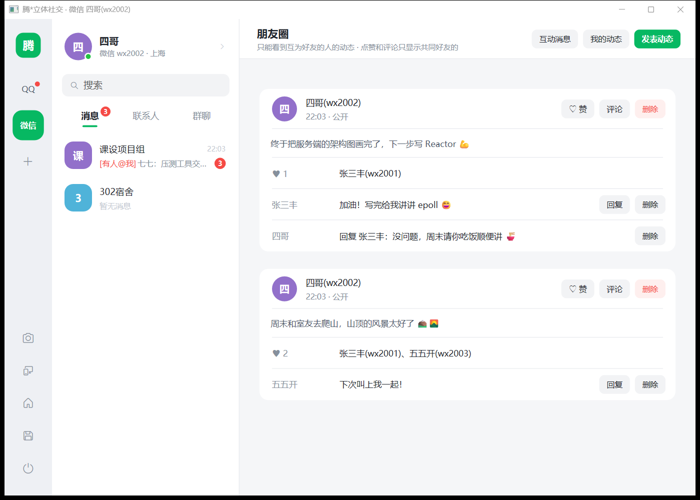
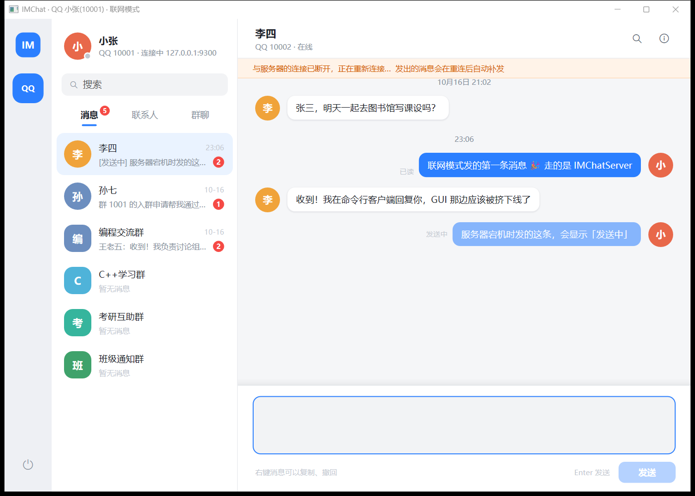
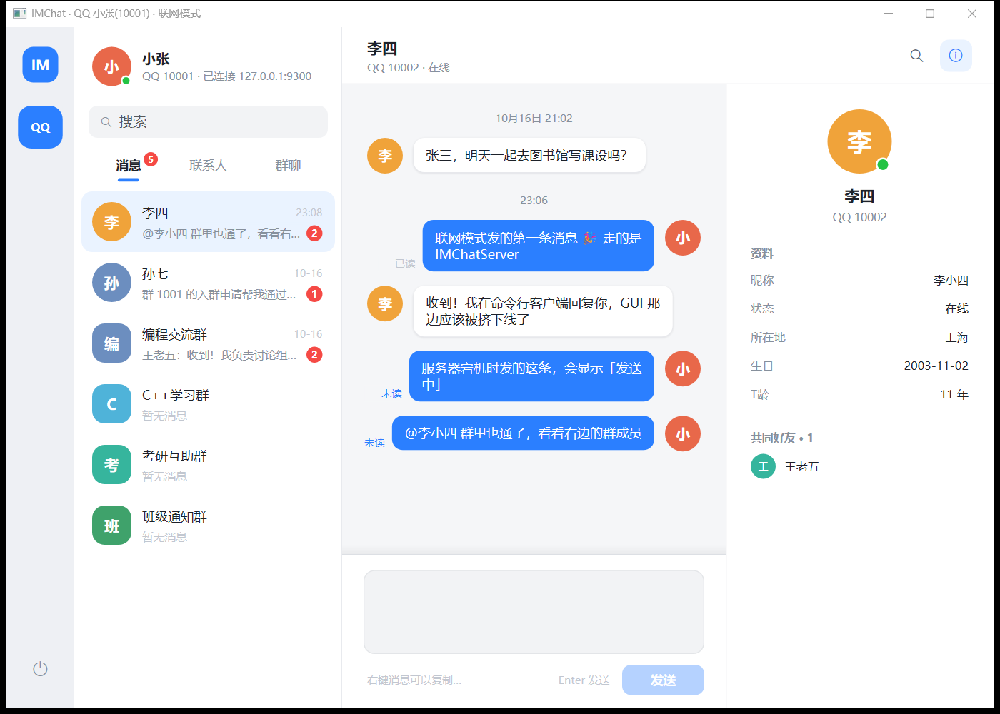

# IMChat

一个用 C++17 从零实现的即时通信系统：QQ / 微信 / 微博 / 微商四种服务共用一套账号体系，支持好友、群聊、朋友圈、消息撤回、@提醒等功能。

- **服务端** `IMChatServer`：基于自己实现的 Reactor 网络库（非阻塞 I/O + 事件循环），使用自定义的二进制协议。功能包括：私信和群消息的确认与在线推送、离线消息同步、已读回执、单点登录、心跳超时、消息去重。
- **网络客户端库** `ChatClient`：自动重连（指数退避）、心跳检测、待确认队列与断线重发。服务端宕机期间发出的消息，恢复后会送达，并且只送达一次。命令行客户端 `IMChatCli` 基于这个库。
- **图形客户端**：不依赖任何界面库，用 Win32 + Direct2D 自绘，有两种模式。
  - **联网模式**：通过服务端工作。一处登录，本人的 QQ、微信、微博同时在线（服务端签发的登录令牌），导航栏切换服务，其他服务的未读实时显示。
    - 聊天：私信、群聊、离线消息、已读/未读、好友在线状态、撤回、@提醒；断线时显示"发送中"，重连后自动补发。
    - 好友：好友申请与验证（对方实时收到提醒）、同意时设置备注、修改备注、单向删除、黑名单、好友资料页。
    - 群管理：建群/解散、申请与审批、邀请、踢人、管理员、禁言、公告、改名、转让、切换管理模式、讨论组。权限由服务端按群的管理策略检查，系统提示实时推送给在线成员。
    - 朋友圈：发表（公开 / 私密 / 部分可见 / 不给谁看）、点赞、评论与回复；好友的动态和互动实时刷新。
  - **单机模式**：直接读写本地数据。另有几项只操作本机的功能：注册与开通服务、跨服务好友推荐、点对点聊天、实时群聊室。
- **控制台客户端**：单机模式。
- **压测工具** `IMChatBench`：在单线程服务端上测得私信 **4 万条/秒**（p99 9 ms）、100 人群消息 **1.6 万条/秒**（每秒推送 157 万条）。压测发现了两个瓶颈：每条消息都要完整解析两遍消息文件，以及群发时每条推送一次系统调用。分别改为增量读取和合并写后，私信吞吐提高约 260 倍，群消息提高约 11 倍。详见 [压测报告](docs/BENCHMARK.md)。

> 项目最初是面向对象程序设计的课程设计，之后持续扩展，正在从"多个客户端共享本地数据文件"改造为客户端/服务端架构。进度见 [路线图](docs/ROADMAP.md)。




## 功能

| 模块 | 内容 |
|---|---|
| 账号 | 一个用户可开通 QQ、微信、微博、微商四种服务；QQ 与微博共享号码，微信/微商可绑定 QQ；一处登录、其他服务同步登录 |
| 好友 | 好友申请与验证、备注、单向删除、黑名单、跨服务的共同好友与好友推荐 |
| 群 | QQ 群模式（群主 + 管理员，可申请入群）与微信群模式（仅群主有特权，只能邀请入群）可在线切换；禁言、群公告、临时讨论组、群系统提示 |
| 消息 | 私信与群消息、未读计数、聊天记录查询、@提醒（含 @所有人）、2 分钟内撤回、群主/管理员撤回成员消息 |
| 朋友圈 | 发表（公开 / 私密 / 部分可见 / 不给谁看）、点赞、评论与回复；只显示共同好友的互动 |
| 实时通信 | TCP 点对点聊天、多人实时群聊室（`select` 多路复用的服务端） |
| 数据 | 纯文本存储，写入采用"临时文件 + 刷盘 + 原子替换"；多个客户端同时运行时检测冲突并另存，不会互相覆盖 |

## 服务端

```
            ┌──────────────── 事件循环线程 ────────────────┐
 客户端 ──TCP──▶ Poller ──▶ TcpConnection ──▶ 帧解码 ──▶ ChatServer ──▶ Platform（业务规则、存储）
                (poll)     输入/输出缓冲区    (半包/粘包)   会话、推送、去重
            └───────────────────────────────────────────────┘
```

- **Reactor**：`EventLoop` 在一个线程里循环执行"等待 I/O 事件 → 分发给连接 → 执行定时器 → 执行其他线程投递的任务"。I/O 多路复用抽象成 `Poller` 接口。目前的实现基于 `poll`（Windows 上是 `WSAPoll`），一份代码两个平台通用；以后在 Linux 上加 `EpollPoller`，事件循环不用改。
- **跨线程唤醒**：其他线程用 `runInLoop` 投递任务，再往一对互连的套接字里写一个字节，唤醒阻塞在 `poll` 上的事件循环。Linux 用 `socketpair` 建这对套接字；Windows 没有 `socketpair`，就在回环地址上自己连自己。
- **非阻塞发送与合并写**：调用 `send` 时先放进输出缓冲区，本轮事件处理完后统一写出，同一轮里发给同一连接的多条消息合并成一次系统调用（群发时效果明显）。写不完的部分留在缓冲区，等可写事件再继续写；只有缓冲区里有数据时才关心可写事件，避免 `poll` 空转。如果对方长时间不读、积压超过 8 MiB，就断开连接，防止慢速客户端拖垮服务端内存。
- **协议**：`[4 字节长度][2 字节类型][JSON]`，按长度切分以处理半包和粘包；长度超过上限时直接断开。详见 [PROTOCOL.md](docs/PROTOCOL.md)。
- **会话**：同一账号只能在一处登录，新登录会把旧连接挤下线；超时没有收到心跳的连接会被关闭；服务端按客户端生成的 `clientMsgId` 去重，重发的消息只保存一次、只推送一次。

### 图形客户端的联网模式

登录页右上角切换到"联网"，填写服务器地址即可。也可以用命令行参数直接登录：

```powershell
build\bin\Release\IMChatClient.exe --server 127.0.0.1:9000 --login QQ 10001 123456
```

| 断线时：顶部提示正在重连，刚发的消息显示"发送中"，重连后自动补发 | 群聊：成员和角色、@提醒、撤回都通过服务端同步 |
|---|---|
|  |  |

界面通过 `Session` 接口取数据，有两种实现（桥接模式）：`LocalSession` 直接调用本地业务类，`RemoteSession` 基于 `ChatClient` 和本地缓存。

`RemoteSession` 的线程处理：
- `ChatClient` 的回调在网络线程里执行，不直接修改缓存，而是把"要做的修改"放进收件箱。
- 界面线程定时取出收件箱里的修改并执行，所以缓存只在界面线程里读写，不需要加锁。

### 两台电脑之间聊天

```powershell
# 电脑 A：启动服务端（--data 指定数据目录，--verbose 输出调试日志）
build\bin\Release\IMChatServer.exe --port 9000

# 电脑 A、B：各开一个命令行客户端（把 IP 换成电脑 A 的局域网地址）
build\bin\Release\IMChatCli.exe --host 192.168.1.10 --port 9000 QQ 10001 123456
build\bin\Release\IMChatCli.exe --host 192.168.1.10 --port 9000 QQ 10002 123456
```

命令行客户端的命令：`/to 账号 内容` 发私信，`/g 群号 内容` 发群消息，`/read` 把当前会话标为已读，`/status` 查看连接状态。

```
  [22:41] 10001：你好，我是张三，这条走的是 IMChatServer 👋   #7
* 当前会话：10001
  ✓ 已送达 #8
* 正在连接                ← 服务端宕机
* 已登录                  ← 服务端恢复，自动重连并重新登录
  [22:41] 10001：服务端挂了的时候发的这条，会在它恢复后补发   #9
```

## 设计要点

- **策略模式**：群管理规则抽象为 `GroupPolicy`，`QQGroupPolicy` / `WeChatGroupPolicy` 实现各自的权限判断（能否踢人、禁言、撤回……），群在运行时切换策略而不改动数据。
- **命令模式**：群操作封装成 `GroupCommand`，由 `GroupService` 执行。单机模式在本机执行，联网模式序列化后发给服务端执行同一个函数，两种模式共用一份群管理规则。
- **观察者模式**：`Group` 发生变化（邀请、退群、禁言、改名……）时通知 `GroupListener`，由 `Platform` 生成群系统提示；群对象不依赖消息模块。
- **多态**：四种服务派生自 `ServiceBase`，各自实现资料展示、朋友圈名称（QQ空间 / 朋友圈 / 微博动态 / 商品动态）等差异。
- **追加式事件日志**：消息、好友申请、点赞、撤回等都作为记录追加到 `messages.txt`（`FILE_APPEND_DATA` 保证每条记录完整写入）。解析结果缓存在内存里，每次只读取新追加的部分（增量读取），多个窗口、多个进程共享同一个文件，状态保持一致。
- **自绘界面**：图形客户端直接用 Direct2D / DirectWrite 绘制，包括消息气泡、对话框、右键菜单、彩色表情；绘制时登记可点击区域，点击判断和绘制使用同一个矩形。
- **全 UTF-8**：程序内部统一使用 UTF-8，只在调用 Windows 宽字符 API（文件路径、控制台、界面）时转换。

## 构建与运行

需要 Windows 10/11 和 Visual Studio 2022（带"使用 C++ 的桌面开发"）。

```powershell
cmake -S . -B build -G "Visual Studio 17 2022" -A x64
cmake --build build --config Release
ctest --test-dir build -C Release        # 运行测试

scripts\reset_demo_data.bat              # 第一次运行前：把演示数据复制到 data\
build\bin\Release\IMChatClient.exe       # 图形客户端
build\bin\Release\IMChatConsole.exe      # 控制台客户端
```

也可以直接用 VS 2022 "打开文件夹"。演示账号的密码都是 `123456`，例如 QQ `10001`、微信 `wx2001`。同时打开多个客户端并登录不同账号，就能互相聊天：

```powershell
build\bin\Release\IMChatClient.exe --login QQ 10002 123456
```

## 目录结构

```
src/core/      业务核心：账号、好友、群与群策略、消息日志、朋友圈、数据文件
src/protocol/  协议：帧编解码、JSON 消息（不依赖平台）
src/reactor/   网络库：Poller、EventLoop、TcpServer、TcpClient、TcpConnection（Windows / POSIX）
src/server/    聊天服务端
src/client/    网络客户端库 ChatClient（重连、心跳、可靠发送）
src/cli/       命令行客户端
src/bench/     压测工具
src/net/       旧的阻塞式网络代码（控制台版的点对点聊天、实时群聊室）
src/console/   控制台客户端
src/gui/       图形客户端（Win32 + Direct2D）
tests/         测试：业务核心测试 + GoogleTest 单元测试与集成测试
third_party/   nlohmann/json
data_demo/     演示数据
docs/          协议、路线图、截图
```

## 测试

```powershell
ctest --test-dir build -C Release
```

每次推送都由 GitHub Actions（[.github/workflows/ci.yml](.github/workflows/ci.yml)）在 Windows 上编译（警告视为错误）、运行全部测试、乱序重复运行单元测试，并跑一遍私信和群消息的压测，确认推送一条不少。

- `tests/TestMain.cpp`（356 项检查）：直接调用业务接口，每个用例从同一份基线数据开始，在独立的临时目录中运行。覆盖账号绑定规则、两种群模式的权限、模式切换不损坏数据、保存与重新加载、加载时修复不一致的数据、两个窗口同时修改时的冲突处理、编码转换、含中文的数据路径、好友申请、撤回、朋友圈可见范围等。
- `tests/unit/`（GoogleTest，60 个用例）：
  - 协议：半包、粘包、非法长度、JSON 往返。
  - 网络库：缓冲区、定时器、跨线程任务、4 MiB 数据的分段发送、50 个并发连接、客户端在服务端恢复后自动重连。
  - 服务端集成测试：用真实套接字验证以下内容：
    - 登录，私信与群消息的推送，离线同步（含分批），已读回执；
    - 好友在线状态推送，联系人与群资料接口（含按管理策略计算的权限），撤回及其推送，@提醒；
    - 好友申请与验证、关闭验证后直接添加、备注、单向删除、黑名单，服务端重启后好友关系仍在；
    - 群详情中按策略算出的权限，审批入群后系统提示和数据变化的推送，越权和参数类型错误的请求被拒绝，切换模式后成员数据不变且重启后仍在，建群与解散；
    - 朋友圈的可见范围（私密、不给谁看）、点赞评论与互动消息、不能删除别人的动态；
    - 登录令牌：篡改、过期、换密钥后失效；凭令牌登录本人的其他服务，不能登录别人的账号，服务端重启后仍然有效；
    - 重发去重，重复登录挤下线，心跳超时，非法帧与非法 JSON。
  - 客户端端到端测试：服务端停机期间发出的消息，恢复后恰好送达一次；被挤下线的客户端不会自动重连。
